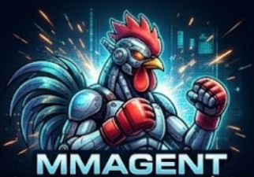

<div align="center">



# MM Agent

**Your own AI assistant on Windows: a smart brain plus a chat interface, installed with one click.**
Talk to it in your browser, on Telegram or on WhatsApp, using DeepSeek, OpenAI, Anthropic or Kimi.


[**⬇ Download the latest installer**](../../releases/latest) · [Quick start](#-quick-start) · [Chat apps](#-chat-apps-telegram--whatsapp) · [Troubleshooting](#-troubleshooting)

</div>

---

## ✨ What is MM Agent?

MM Agent joins two well-known open-source AI projects into one easy app:

| Part | Program | What it does |
|---|---|---|
| 🧠 **Brain** | [Hermes Agent](https://github.com/nousresearch/hermes-agent) (Nous Research) | Thinks and acts: talks to the AI model, remembers, learns skills, uses tools |
| 💬 **Interface** | [OpenClaw](https://github.com/openclaw/openclaw) | Where you chat: a web chat page, Telegram, WhatsApp |

```
You ──► OpenClaw (chat page / Telegram / WhatsApp) ──► Hermes (brain) ──► DeepSeek / OpenAI / Anthropic / Kimi
```

Everything runs **on your own PC**. You bring your own API key, so there is no subscription and no middleman.

### Features

- **One-click installer**: installs Node.js, Hermes Agent and OpenClaw for you. No admin rights, no command line.
- **Four AI providers**: DeepSeek, OpenAI, Anthropic (Claude) and Kimi (Moonshot). Switch any time.
- **Your keys stay private**: API keys are encrypted with Windows' own protection (DPAPI) and only work for your Windows account on your PC.
- **Chat anywhere**: browser chat page, Telegram bot and WhatsApp. Only people you approve can talk to it.
- **Two control panels**: the OpenClaw chat page and the Hermes brain dashboard (sessions, skills, logs).
- **Self-repairing setup**: detects and fixes common problems (half-finished updates, damaged settings, PATH issues).

## 🚀 Quick start

### Requirements

- Windows 10 (22H2) or Windows 11, 64-bit
- Internet connection (setup downloads several hundred MB the first time)
- An API key from at least one AI provider:

  | Provider | Get a key |
  |---|---|
  | DeepSeek (default, low cost) | https://platform.deepseek.com |
  | OpenAI | https://platform.openai.com/api-keys |
  | Anthropic (Claude) | https://console.anthropic.com |
  | Kimi (Moonshot) | https://platform.moonshot.ai |

### Install

1. Download **`MM-Agent-Setup.exe`** from the [latest release](../../releases/latest).
2. Double-click it. Windows may say **"Windows protected your PC"** because the installer isn't code-signed. Click **More info → Run anyway**.
3. Click **Next → Install → Finish**. Leave **"Set up MM Agent now"** ticked.
4. A setup window opens and installs everything. This takes **5–15 minutes**; leave the window open.
5. When asked, **paste your API key(s)**. The input is hidden. Press Enter to skip a provider.
6. Optionally connect **Telegram** and/or **WhatsApp** (you can also do it later).
7. Press **Enter** to start. Your browser opens the chat page. 🎉

## 🖥 Using MM Agent

Everything is in **Start Menu → MM Agent**:

| Shortcut | What it does |
|---|---|
| **Start MM Agent** | Starts everything and opens the chat page |
| **Stop MM Agent** | Stops everything |
| **Enter API Keys** | Add or change your API keys |
| **Switch Model** | Choose which AI answers (DeepSeek, OpenAI, Anthropic, Kimi) |
| **Connect Telegram / Connect WhatsApp** | Link a chat app |
| **Approve Telegram / Approve WhatsApp** | Allow a person who messaged your bot |
| **Voice Messages** | Understand voice notes and answer them with voice (WhatsApp/Telegram) |
| **Update MM Agent** | Update Hermes Agent, OpenClaw and Node.js now (it also happens by itself every day) |
| **MM Agent Setup** | Re-run setup: updates and repairs everything |

### After a restart

Setup is only needed **once**. MM Agent starts **automatically when you sign in to Windows**, quietly in the background,
so Telegram and WhatsApp keep answering and the chat page is ready at http://127.0.0.1:18789/.
Open it from your browser's bookmarks or with **Start MM Agent**, which also opens both pages.
To turn auto-start off, run the installer again and untick **"Start MM Agent automatically when I sign in to Windows"**,
or delete **MM Agent** from the Startup folder (press Win+R, type `shell:startup`).

### Automatic updates

MM Agent keeps **Hermes Agent, OpenClaw and Node.js up to date by itself**, once a day:
- **at Windows sign-in**, before it starts (only the first sign-in of the day), and
- **every day at 04:00** for PCs that stay switched on (Task Scheduler task "MM Agent Daily Update").
  MM Agent stops for a few minutes, updates, and starts again.

Your API keys, chats and settings are kept. If an update fails, MM Agent still starts with the old version and tries again
next time. Progress is written to `logs\update.log`. To update right now, use **Update MM Agent** in the Start Menu.
To turn automatic updates off, run the installer again and untick **"Update Hermes Agent, OpenClaw and Node.js automatically every day"**.

> **Don't use `/update` in Telegram/WhatsApp or OpenClaw's own updater.** OpenClaw can only replace its files while it is
> stopped, so updating from inside the running chat always fails with `gateway-stop-unverified`. MM Agent's updater stops it first.

When MM Agent is running, two pages are available:

| Page | Address | Use it for |
|---|---|---|
| **Chat (OpenClaw)** | http://127.0.0.1:18789/ | Everyday chat, the same assistant as on Telegram/WhatsApp |
| **Brain panel (Hermes)** | http://127.0.0.1:9119/ | Hermes' own chat, sessions, models, skills and logs |

> `127.0.0.1:8642` is the brain's internal connection for OpenClaw. It is not a web page.
> The Hermes dashboard builds its pages on its first start, which takes a few minutes once.

## 🎓 Course questions

MM Agent answers clients' course questions from your course documents. The **mm-course-info** plugin (read-only, no tools) gives every chat:
- every `.md` / `.txt` file in `%USERPROFILE%\.openclaw\workspace\rag\corpus` (sections whose heading says *內部備註* / *internal note* are left out), and
- the customer-service rules: answer only from the documents, in the client's language; a fixed polite reply when something isn't covered; never recommend other courses; never reveal the model, keys, files or links.

To change course details, edit or add files in that folder: the next reply uses them. To change the rules, copy
`openclaw-plugin\mm-course-info\rules.md` (in the MM Agent folder) to `%USERPROFILE%\.openclaw\mm-course-rules.md` and edit that copy.

## 📱 Chat apps (Telegram & WhatsApp)

Strangers who message your bot or number get a **pairing code**. Nobody can talk to MM Agent until you approve them. In group chats it only answers when @mentioned.

### Telegram

1. In Telegram, message **@BotFather**, send `/newbot` and copy the token it gives you.
2. Start Menu → **Connect Telegram**, then paste the token.
3. Start MM Agent and send your bot a message. It replies with a pairing code.
4. Start Menu → **Approve Telegram**, then type the code. Codes expire after 1 hour.

### WhatsApp

1. Start Menu → **Connect WhatsApp**. The first time, it installs OpenClaw's WhatsApp plugin, then shows a QR code.
2. On your phone: **WhatsApp → Settings → Linked devices → Link a device**, then scan the QR code.
3. Start MM Agent. From **another phone**, message the linked number. It replies with a pairing code.
4. Start Menu → **Approve WhatsApp**, then type the code.

### 🎙 Voice messages

Start Menu → **Voice Messages** (setup also offers it). Then:
- **Voice notes are understood** in any language (Cantonese, English, Mandarin, ...). They are turned into text **on your PC**
  with [whisper.cpp](https://github.com/ggml-org/whisper.cpp): free, no API key, the audio never leaves your computer.
  With an NVIDIA graphics card this takes about 1 second; on the processor alone it takes longer.
- **A voice note gets a voice note back** (plus the text), in Microsoft's free voices: Cantonese for Chinese replies,
  English for English. Typed messages still get text only.

| Want | Do |
|---|---|
| Voice reply to every message | `Setup-Voice-Messages.cmd -Reply always` |
| Understand voice, but reply with text only | `Setup-Voice-Messages.cmd -Reply off` |
| Mandarin voice instead of Cantonese | set `"chinese": "mandarin"` in `%LOCALAPPDATA%\MM Agent Voice\voice.json` |

It downloads about 0.6 GB once (1.3 GB with an NVIDIA card) into `%LOCALAPPDATA%\MM Agent Voice`.

> ⚠️ WhatsApp is linked like WhatsApp Web, through an unofficial library. **Use a separate WhatsApp number if you can**: WhatsApp may restrict numbers it believes are automated. Telegram bots are official and have no such risk.

## 🔒 Privacy & security

- **API keys** are stored encrypted (Windows DPAPI) in `%USERPROFILE%\.mm-agent\keys.env`. Only your Windows account on your PC can decrypt them, and the folder is locked to your user. Keys are decrypted in memory only when MM Agent starts.
- **Everything is local**: the brain and the chat interface listen on `127.0.0.1` only, so other computers can't reach them. A private random key protects the link between them.
- **Your messages** go from your PC directly to the AI provider you chose, under that provider's terms.
- **Chat apps can't control your PC**: messages from WhatsApp, Telegram and the chat page get no brain tools (no terminal, files, code, browser, memory or cross-chat search). Only the Hermes dashboard on your PC has them. Keep it that way if strangers can message your number.
- **Voice messages**: voice notes are transcribed on your PC. For voice *replies*, the reply text is sent to Microsoft's free speech service to make the audio.
- **Don't type API keys into the Hermes dashboard**: it stores them unencrypted. Use **Enter API Keys** instead.
- MM Agent installs per-user and **never needs administrator rights**.

## 🗑 Uninstall

Windows **Settings → Apps → MM Agent → Uninstall**. This removes MM Agent's shortcuts and scripts.
Hermes Agent, OpenClaw and your encrypted keys are kept, so you can reinstall without setting up again. To remove them too, delete:
`%LOCALAPPDATA%\hermes`, `%LOCALAPPDATA%\OpenClaw`, `%USERPROFILE%\.openclaw` and `%USERPROFILE%\.mm-agent`.

## 🛠 Troubleshooting

**First, run Start Menu → MM Agent Setup.** It checks and repairs Node.js, Hermes, OpenClaw and the link between them. Its first lines show where everything is installed; include a screenshot of them when you ask for help.

<details>
<summary><b>Known problems and fixes</b> (click to open)</summary>

| Message | Cause and fix |
|---|---|
| `OpenClaw did not install` / `'openclaw' is not recognized` | OpenClaw's folder is missing from PATH. **MM Agent Setup** finds it and fixes PATH, or reinstalls it. |
| `os error 448` / `untrusted mount point` | Windows' **RedirectionGuard** was on (Inno Setup 6.7 turns it on and it is passed to everything the installer starts). Fixed since 1.0.4: the installer turns it off, and setup/start reopen themselves in a normal window if needed. |
| `uv trampoline failed to spawn Python child process` | Hermes' private Python is missing (cut-short install, or antivirus). **MM Agent Setup** re-runs the Hermes installer. If it still fails, setup lists the MISSING file; restore it in Windows Security → Protection history. |
| `requested interpreter resolved to Python 3.11 ... incompatible with ==3.14.*` | A Hermes update stopped halfway. **MM Agent Setup** detects it and finishes the update (1–10 minutes). |
| `Replacement credential saved but inactive` | OpenClaw 2026.10.6+ answers a repeat link this way. Setup skips re-linking; if the key really changed, **Start MM Agent** activates the new sign-in. |
| `OutOfMemoryException` reading `.env` | Hermes' settings file grew huge after damage. Setup rebuilds it from its valid lines and keeps the damaged copy as `.env.mm-corrupt.<date>`. |
| `uses schema version N ... run openclaw doctor --fix` (interface won't start) | OpenClaw updated itself and must upgrade its database once. Since 1.1.1, **Start MM Agent** backs up the databases (in `%USERPROFILE%\.openclaw\backups`), runs `openclaw doctor --fix` and starts again. This can take 5–15 minutes. |
| Red `NativeCommandError` around a normal message (e.g. `Installing TUI dependencies…`) | Not an error: Windows PowerShell shows messages from a program's error channel in red. Since 1.1.3 MM Agent shows them as plain text. Look for a real failure message (e.g. `failed`, `did not start`) instead. |
| "Unable to finish this reply: Couldn't connect to the AI service" | The brain (Hermes) had stopped. Since 1.1.2 it restarts itself within seconds; otherwise use **Stop MM Agent** then **Start MM Agent**. |
| Replies are slow | Use **Switch Model** → DeepSeek `deepseek-v4-flash` (the default since 1.1.2), and keep OpenClaw's thinking level low or off. |
| Every reply is "OpenClaw couldn't finish this reply" (`unknown_execution` in `logs\brain.log`) | The brain restarted in the middle of a reply and Hermes blocked that conversation. Since 1.1.6 the brain healer clears it within a minute; to do it by hand: `hermes sessions discard <session> --yes`. |
| Chats stop answering; `logs\interface.log` repeats "Another gateway ... already owns this state directory" | A second copy of OpenClaw was started outside MM Agent (OpenClaw's own autostart). Since 1.1.7 MM Agent turns it off at every start: **Stop MM Agent**, then **Start MM Agent**. |
| Replies contain `<\|DSML\| calls>` / `invoke name=...` text | The brain was told about tools it can't use. Since 1.1.6 setup sets `compat.supportsTools: false` on the brain model; run **MM Agent Setup** once. |
| `OpenClaw update failed: gateway-stop-unverified` (e.g. after `/update` in WhatsApp) | OpenClaw cannot update itself while it is running. Nothing broke. Since 1.1.5 MM Agent updates it every day by itself; to update now use **Update MM Agent**. |
| `A gateway is already running` | An old brain was still running. Start replaces it automatically. |
| Hermes dashboard doesn't open | The chat page still works. Run **MM Agent Setup** to repair Hermes, then start again. |
| "Windows protected your PC" | The installer isn't code-signed. Click **More info → Run anyway**. |

Useful checks:
- `hermes doctor`: checks Hermes and tests your keys.
- `openclaw gateway status`: checks the chat interface.
- http://127.0.0.1:8642/health should show `{"status": "ok"}` while MM Agent runs.
- Logs are in `%LOCALAPPDATA%\Programs\MM Agent\logs`. Check them for keys before sharing; the scripts never write keys there, but it's good practice.

</details>

## 🏗 Build from source

MM Agent itself is a set of PowerShell scripts plus an [Inno Setup](https://jrsoftware.org/isinfo.php) installer.

```powershell
# 1. Install the installer compiler (once)
winget install --id JRSoftware.InnoSetup -e --scope user

# 2. (Optional) rebuild the icon from installer\mmagent-source.jpg
powershell -ExecutionPolicy Bypass -File installer\make-icon.ps1

# 3. Build dist\MM-Agent-Setup.exe
powershell -ExecutionPolicy Bypass -File installer\build-installer.ps1
```

<details>
<summary><b>Project structure</b></summary>

```
MM Agent/
├─ *.cmd                    Double-click launchers (also the Start Menu shortcuts)
├─ scripts/
│  ├─ common.ps1            Shared settings and helpers
│  ├─ first-run.ps1         Setup wizard: install, repair, keys, linking, chat apps
│  ├─ install-node.ps1      Latest Node.js (per-user, checksum-verified)
│  ├─ install-hermes.ps1    Official Hermes Agent installer
│  ├─ install-openclaw.ps1  Official OpenClaw installer
│  ├─ setup-bridge.ps1      Links OpenClaw to Hermes' local API
│  ├─ enter-api-keys.ps1    Encrypted key entry (DPAPI)
│  ├─ switch-model.ps1      Choose provider and model
│  ├─ start.ps1 / stop.ps1  Run MM Agent
│  ├─ connect-telegram.ps1, connect-whatsapp.ps1, approve-chat.ps1
├─ installer/
│  ├─ MM-Agent.iss          Inno Setup script
│  ├─ build-installer.ps1   Builds dist\MM-Agent-Setup.exe
│  ├─ make-icon.ps1         Builds mmagent.ico from mmagent-source.jpg
└─ dist/                    Build output (not in git; published on Releases)
```

</details>

## 🙏 Credits

MM Agent is free and stands on the shoulders of these open-source projects. It downloads them from their official sources during setup and does not include or change their code:

- [Hermes Agent](https://github.com/nousresearch/hermes-agent) by Nous Research (MIT)
- [OpenClaw](https://github.com/openclaw/openclaw) by the OpenClaw Foundation (MIT)
- [Node.js](https://nodejs.org) (MIT)
- [Inno Setup](https://jrsoftware.org/isinfo.php) by Jordan Russell and Martijn Laan, used to build the installer

MM Agent is an independent community project and is not affiliated with or endorsed by Nous Research, the OpenClaw Foundation, OpenAI, Anthropic, DeepSeek, Moonshot AI, Telegram or WhatsApp.

## 📄 License

MM Agent is released under the [MIT License](LICENSE): free to use, copy, change and share.
You pay only your AI provider for the API usage you choose.
